# 🥂 Partyspiele – Imposter & Quiz

**Ein Handy, viele Freunde, drei Spiele.** Das Handy wird reihum weitergegeben, jeder schaut geheim auf seine Karte und danach wird diskutiert, geraten und gelacht. Die App läuft im Browser, lässt sich auf dem Handy installieren und funktioniert danach auch ohne Internet.

<p align="center">
  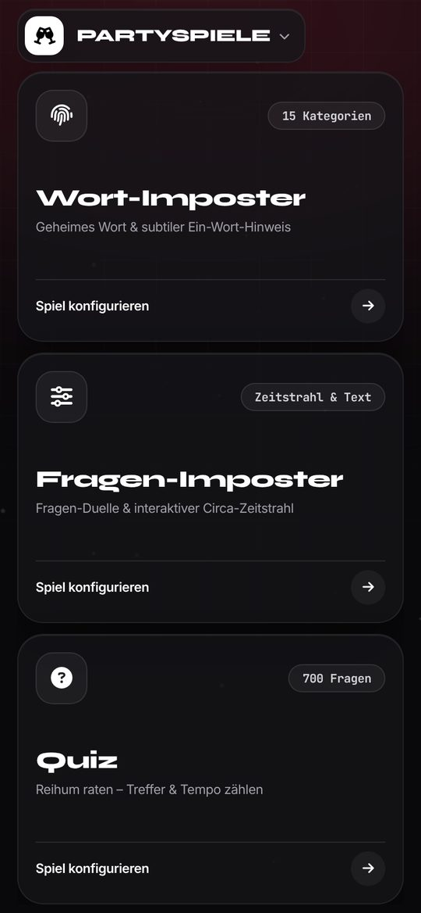
</p>

---

## 🎮 Die drei Spiele

### 1. Wort-Imposter

Alle bekommen dasselbe geheime Wort, nur der **Imposter** nicht. Er sieht stattdessen ein zweideutiges **Hinweis-Wort** (kann man auch ausschalten).

1. Im Setup Spieler, Anzahl Imposter, Timer und Kategorien einstellen und **„Runde starten“** tippen.
2. Das Handy geht reihum. Jeder tippt auf die verdeckte Karte, schaut sich geheim seine Rolle an, tippt **„Verbergen & weitergeben“** und gibt das Handy weiter.
3. Danach nennt jeder reihum **ein Wort**, das zum geheimen Wort passt. Nicht zu offensichtlich, sonst errät der Imposter es.
4. Gemeinsam diskutieren und abstimmen, wer der Imposter ist. Dann **„Auflösung anzeigen“**.

<p align="center">
  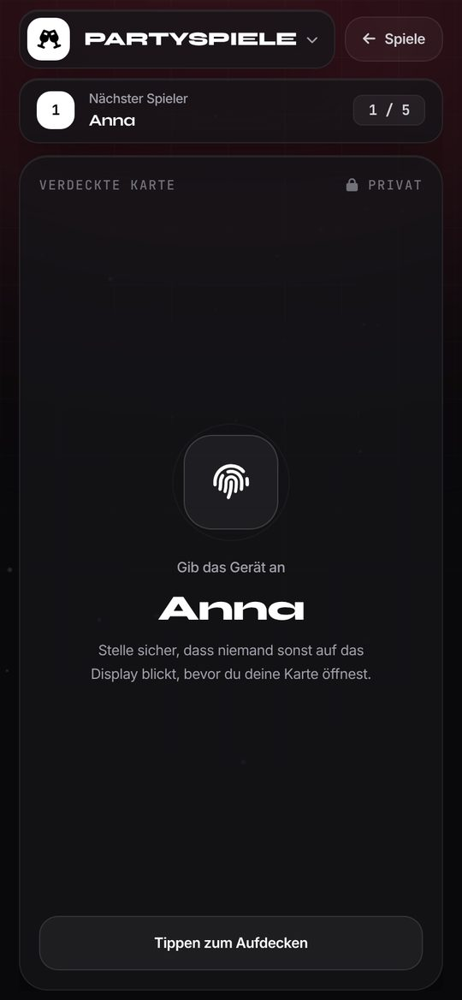
  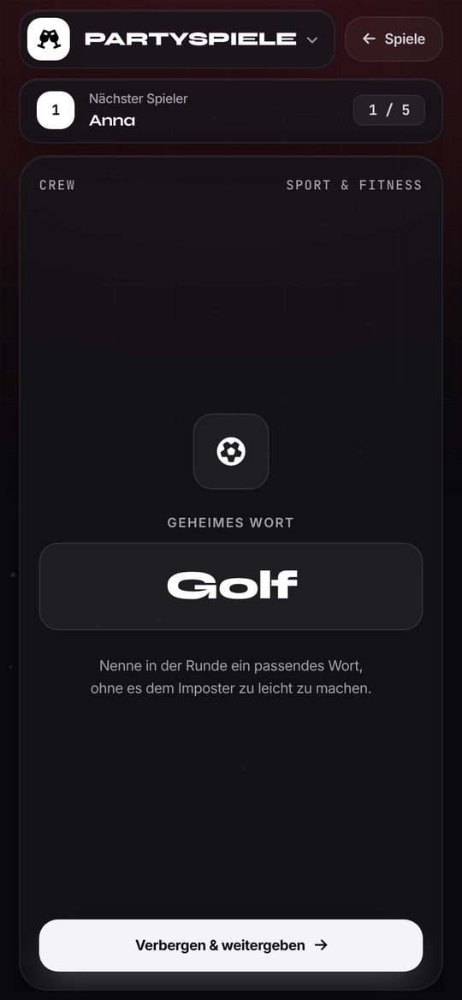
  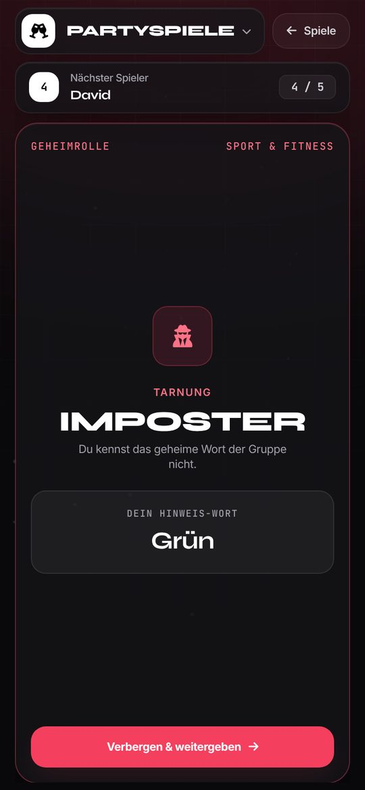
  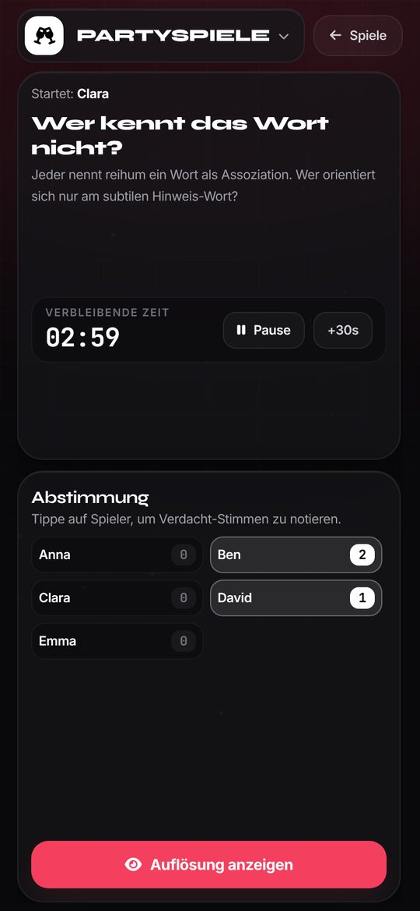
</p>
<p align="center"><sub>Verdeckte Karte · Crew sieht das Wort · Imposter sieht nur den Hinweis · Diskussion & Abstimmung</sub></p>

**Punkte:** Findet die Crew den Imposter, bekommt jedes Crew-Mitglied +1 Punkt. Bleibt der Imposter unentdeckt (oder errät das Wort), bekommt er +2 Punkte.

### 2. Fragen-Imposter

Alle beantworten geheim **dieselbe Frage**, nur der Imposter bekommt eine **andere Frage**, deren Antwort aber verblüffend ähnlich ist. Bei **Schätzfragen** stellt jeder seine Zahl auf einem Zeitstrahl ein.

1. Jeder liest geheim seine Frage und gibt seine Antwort ein bzw. schiebt den Zeitstrahl.
2. In der Diskussion steht die **Frage der Crew groß oben**, darunter alle Antworten.
3. Jetzt muss jeder seine Antwort verteidigen. Wessen Antwort passt nicht ganz?
4. Bei **„Auflösung anzeigen“** wird der Imposter rot markiert und man sieht beide Fragen und die **richtige Lösung** als Fakten-Check.

<p align="center">
  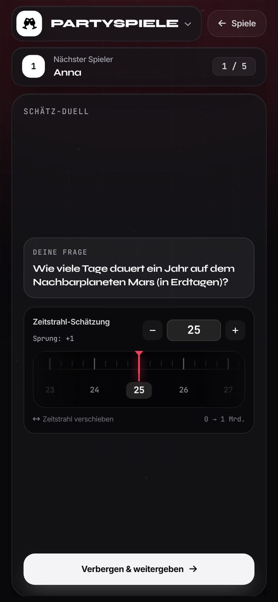
  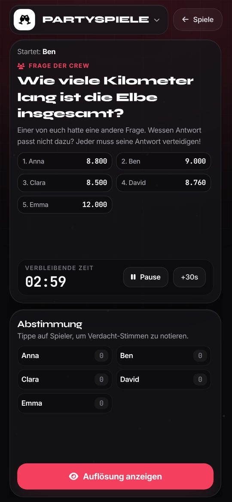
  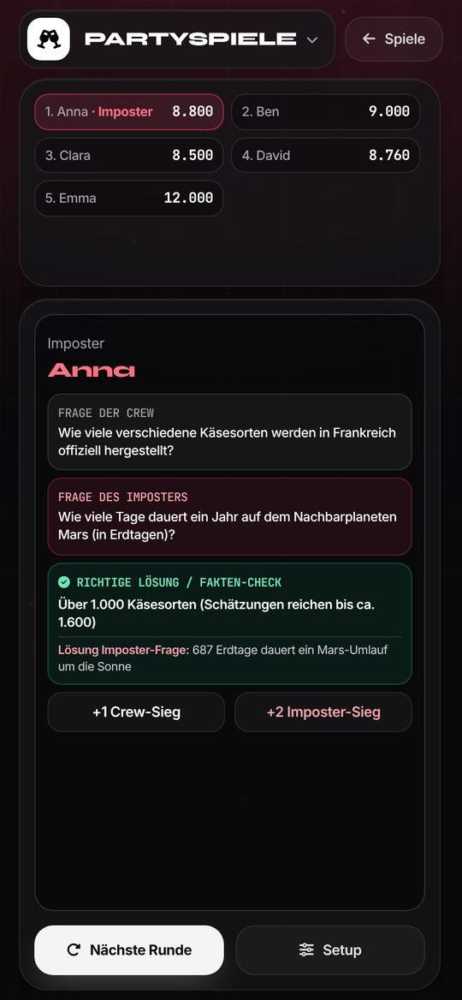
</p>
<p align="center"><sub>Schätzfrage mit Zeitstrahl · Diskussion: Frage oben, Antworten darunter · Auflösung mit Fakten-Check</sub></p>

Es gibt Schätzfragen (Zahlen und Skala 1–10) und normale Fragen. Im Setup unter **Optionen → Fragen-Typ** kann man wählen.

### 3. Quiz

Ein Quiz für alle mit **700 Fragen** in 10 Kategorien. In jeder Runde bekommen alle **dieselbe Frage** mit vier Antworten und beantworten sie nacheinander gegen die Uhr.

1. Das Handy an den angezeigten Spieler geben, der tippt **„Frage starten“**. Ab jetzt läuft die Zeit.
2. Antwort antippen, **„Weiter“** und das Handy weitergeben.
3. Nach allen Runden (Standard: 3) kommt die Rangliste: **Wer die meisten richtig hat, gewinnt. Bei Gleichstand gewinnt, wer schneller war.**

<p align="center">
  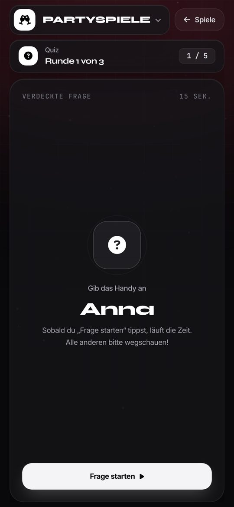
  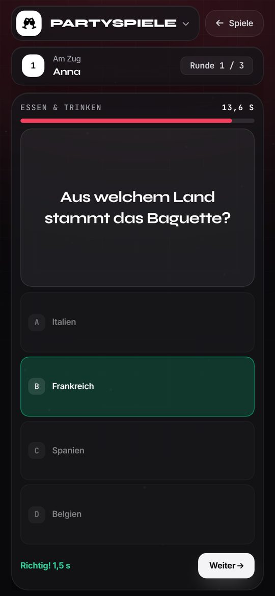
  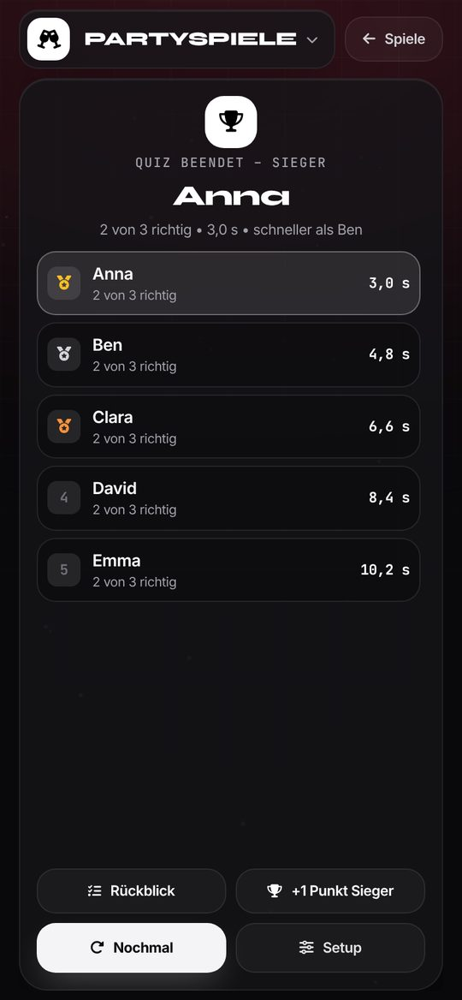
</p>
<p align="center"><sub>Handy weitergeben · Frage gegen die Uhr · Rangliste mit Zeiten</sub></p>

Im Setup kann man Anzahl der Runden, Zeit pro Frage, Kategorien und das Sofort-Feedback (richtig/falsch direkt anzeigen) einstellen.

### Weitere Funktionen
- **Wörter-, Fragen- & Quiz-Tresor** (Logo-Menü): eigene Wörter, Fragen und Quizfragen anlegen, bearbeiten, löschen und als CSV sichern. Mit Passwort geschützt, damit niemand spickt.
- **Punktestand** über mehrere Runden.
- **Design:** 5 Farbschemata, Hell/Dunkel oder automatisch wie das Gerät.
- **Zurück-Wischen** auf dem Handy führt Schritt für Schritt zurück (Runde → Setup → Startseite).

---

## 📲 App öffnen – Schritt für Schritt

Es gibt zwei Wege: **am Computer ausprobieren** oder **auf dem Handy als App installieren**.

### Weg 1: Am Computer ausprobieren

1. Auf GitHub oben auf den grünen Knopf **„Code“** klicken, dann **„Download ZIP“**.
2. **Die ZIP-Datei entpacken – das ist der wichtigste Schritt!**
   - **Windows:** Rechtsklick auf die ZIP-Datei → **„Alle extrahieren …“** → **„Extrahieren“**.
   - **Mac:** ZIP-Datei doppelklicken, sie wird automatisch entpackt.
3. Den **neuen, entpackten Ordner** öffnen und dort auf **`index.html`** doppelklicken.

> ⚠️ **Nicht** `index.html` direkt in der ZIP-Datei doppelklicken! Windows zeigt den Inhalt einer ZIP-Datei zwar wie einen Ordner an, öffnet daraus aber nur die eine Datei. Dann fehlen Design und Spiel-Logik, und man sieht nur eine Liste aus Text und grauen Knöpfen. Die App zeigt in diesem Fall jetzt diesen Hinweis:
>
> 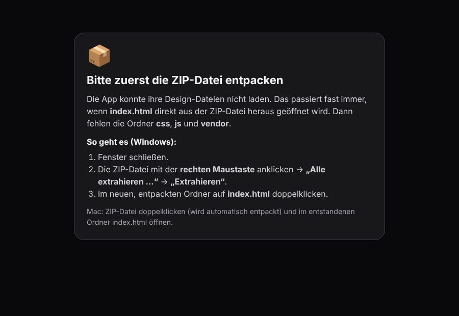
>
> Woran man erkennt, dass man noch in der ZIP-Datei ist: Im Explorer gibt es eine Spalte **„Komprimierte Größe“**.

So kann man sofort am Computer spielen. **Installieren und Offline-Modus gehen auf diesem Weg nicht**, weil Browser das nur für Seiten mit `https://`-Adresse erlauben. Dafür ist Weg 2 da.

### Weg 2: Auf dem Handy als App installieren (empfohlen)

Dafür muss die App einmal im Internet erreichbar sein. Danach installiert man sie mit einem Fingertipp aufs Handy. Am einfachsten geht das kostenlos mit **Netlify**.

#### Variante A: Netlify per Drag & Drop (am einfachsten, ohne GitHub-Einstellungen)

1. Die App wie in Weg 1 herunterladen und **entpacken**.
2. **Den richtigen Ordner finden:** Gemeint ist der Ordner, in dem **direkt** `index.html` liegt, zusammen mit `css`, `js`, `vendor`, `icons`, `sw.js` und `manifest.webmanifest`.
   > Achtung: Windows legt beim Entpacken oft einen Ordner **in** einem Ordner an (z. B. `Impostor-Spiel-…\Impostor-Spiel-…\index.html`). Dann den **inneren** Ordner nehmen, also den, bei dem man `index.html` sofort sieht.
3. Im Browser **[app.netlify.com/drop](https://app.netlify.com/drop)** öffnen (kostenloses Konto anlegen bzw. anmelden).
4. Diesen Ordner **mit der Maus in das Feld ziehen**. Nicht die ZIP-Datei und nicht einzelne Dateien.
5. Nach wenigen Sekunden bekommst du eine Adresse wie `https://irgendein-name-123.netlify.app`. Unter **„Site configuration → Change site name“** kannst du einen schöneren Namen wählen, z. B. `https://unsere-partyspiele.netlify.app`.

Richtig sieht der hochgeladene Ordner so aus:
```
📁 (dieser Ordner wird hochgezogen)
├── index.html
├── manifest.webmanifest
├── sw.js
├── netlify.toml
├── 📁 css
├── 📁 js
├── 📁 icons
├── 📁 vendor
└── 📁 docs        (nur Bilder für diese Anleitung, schadet nicht)
```
Die übrigen Dateien (`README.md`, `package.json`, `tailwind.config.js`, `tools/`, `impostor12.html`) stören nicht, sie werden einfach mit hochgeladen.

**Später aktualisieren:** In Netlify bei der Seite auf **„Deploys“** gehen und den neuen, entpackten Ordner wieder in das Feld ziehen.

#### Variante B: Netlify mit GitHub verbinden (aktualisiert sich automatisch)

1. In Netlify **„Add new site → Import an existing project → GitHub“** wählen und dieses Repository auswählen.
2. Den **Branch** mit der App wählen (z. B. `main`).
3. **Build command:** leer lassen. **Publish directory:** leer lassen bzw. `.` (Punkt).
   Die Datei `netlify.toml` im Repository stellt das bereits richtig ein.
4. **„Deploy“** klicken. Bei jeder Änderung auf GitHub aktualisiert Netlify die Seite automatisch. Das funktioniert auch mit privaten Repositories.

#### Variante C: GitHub Pages

1. Im Repository oben auf **„Settings“** → links **„Pages“**.
2. Bei **„Source“**: **„Deploy from a branch“**, dann den Branch (z. B. `main`) und **`/ (root)`** wählen, **„Save“**.
3. Nach 1–2 Minuten steht oben die Adresse, z. B. `https://<dein-benutzername>.github.io/Impostor-Spiel-1.1/`.

> GitHub Pages ist nur für **öffentliche** Repositories kostenlos. Bei einem privaten Repository lieber Netlify nehmen.

#### Auf dem Handy installieren

Die Adresse von Netlify oder GitHub Pages auf dem Handy öffnen:
- **iPhone / iPad:** in **Safari** → unten auf **Teilen** (Quadrat mit Pfeil) → **„Zum Home-Bildschirm“** → **„Hinzufügen“**.
- **Android:** in **Chrome** → oben rechts **⋮** → **„App installieren“** bzw. **„Zum Startbildschirm hinzufügen“**.

Jetzt liegt **Partyspiele** als App-Icon auf dem Home-Bildschirm, startet im Vollbild und funktioniert auch im Flugmodus. Die Anleitung gibt es auch in der App: Logo antippen → **„Als App installieren“**.

---

## 🛠️ Für Bastler

### Ordnerstruktur

| Datei / Ordner | Inhalt |
| --- | --- |
| `index.html` | Die App: alle Ansichten und Pop-ups |
| `css/app.css` | Eigenes Design (Farben, Themes, Handy-Anpassungen) |
| `js/data-words.js` | **Wort-Imposter:** Kategorien mit Wort + Hinweis |
| `js/data-questions.js` | **Fragen-Imposter:** Fragen-Paare und Schätzfragen mit Lösungen |
| `js/data-quiz.js` | **Quiz:** Fragen mit 1 richtigen und 3 falschen Antworten |
| `js/app.js` | Die Spiel-Logik |
| `vendor/` | Lokale Kopien von Tailwind-CSS, Font Awesome und Schriften (für den Offline-Modus) |
| `icons/` | App-Icons |
| `manifest.webmanifest` | Angaben für die Installation (Name, Icon, Farben) |
| `netlify.toml` | Einstellungen für Netlify (kein Build nötig, Hauptordner veröffentlichen) |
| `sw.js` | Service Worker: speichert die App für die Offline-Nutzung |
| `docs/screenshots/` | Bilder für diese Anleitung |
| `partyspiele.html` | Alte Adresse, leitet auf `index.html` weiter |
| `impostor12.html` | Älteres, separates Spiel (unabhängig von dieser App) |

### Fragen und Wörter bearbeiten
- **In der App:** Logo-Menü → **Wörter-, Fragen- & Quiz-Tresor**. Diese Änderungen werden nur auf dem jeweiligen Gerät gespeichert. Mit **CSV-Export/-Import** kann man sie auf andere Geräte übertragen.
- **Für alle Geräte:** direkt in `js/data-words.js`, `js/data-questions.js` oder `js/data-quiz.js` bearbeiten (das Format steht oben in jeder Datei).

Werden **Standard-Fragen korrigiert**, in `js/app.js` die Zahl bei `DATA_VERSION` um 1 erhöhen. Dann übernehmen auch Geräte mit gespeichertem Spielstand die Korrekturen.

### Updates an installierte Handys verteilen
Die installierte App speichert alle Dateien. Damit Handys eine neue Version bekommen:
1. In `sw.js` die Zeile `const CACHE_VERSION = "partyspiele-v1";` hochzählen (z. B. `v2`).
2. Änderungen auf GitHub hochladen.
3. Die App lädt die neue Version im Hintergrund und zeigt sie beim nächsten Start.

Neue Dateien müssen in `sw.js` in die Liste `PRECACHE` eingetragen werden, damit sie offline verfügbar sind.

### Lokaler Testserver
```bash
python3 -m http.server 8080
```
Dann `http://localhost:8080` öffnen. Hier funktionieren auch Offline-Modus und Installation (nur auf diesem Computer).

### Design-Klassen neu bauen (nur bei Layout-Änderungen)
Das Layout nutzt Tailwind-CSS-Klassen, die fertig in `vendor/tailwind.css` liegen. Nur wenn **neue** Tailwind-Klassen in `index.html` oder `js/*.js` verwendet werden, muss die Datei neu gebaut werden (Node.js nötig):
```bash
npm install
npm run build:css
```

### Lizenzen der eingebundenen Pakete
- Font Awesome Free 6.5.1: Icons CC BY 4.0, Schriftdateien SIL OFL 1.1, Code MIT (siehe `vendor/fontawesome/LICENSE.txt`)
- Schriften Inter, Syne und JetBrains Mono (über Fontsource): SIL Open Font License 1.1 (siehe `vendor/fonts/LICENSE-OFL.txt`)
- Tailwind CSS: MIT
